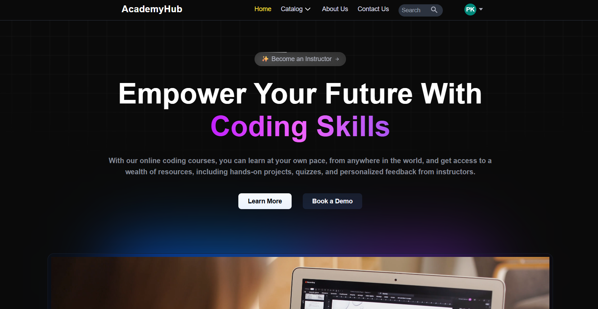
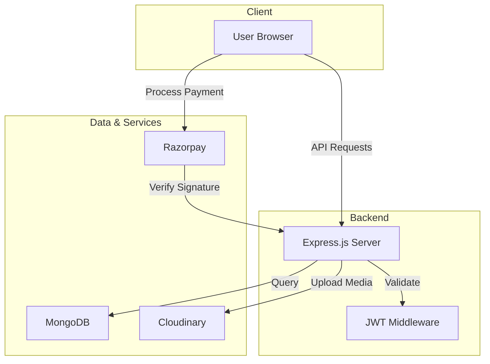

<a name="readme-top"></a>

<br />
<div align="center">
  <a href="https://github.com/priyanshubh/AcademyHub">
    
  </a>

  <h3 align="center">AcademyHub</h3>

  <p align="center">
    Interactive Learning & Teaching Platform
    <br />
    <a href="https://academyhub-pb.vercel.app"><strong>View Demo »</strong></a>
    <br />
    <br />
    <a href="https://github.com/priyanshubh/AcademyHub">View Code</a>
    ·
    <a href="https://github.com/priyanshubh/AcademyHub/issues">Report Bug</a>
    ·
    <a href="https://github.com/priyanshubh/AcademyHub/issues">Request Feature</a>
  </p>
</div>

<div align="center">
  
  
  
  
  
</div>

<br />

<details>
  <summary>Table of Contents</summary>
  <ol>
    <li><a href="#-about-the-project">About The Project</a></li>
    <li><a href="#-key-features">Key Features</a></li>
    <li><a href="#-tech-stack">Tech Stack</a></li>
    <li><a href="#-architecture">Architecture</a></li>
    <li><a href="#-api-design">API Design</a></li>
    <li><a href="#-getting-started">Getting Started</a></li>
    <li><a href="#-contributing">Contributing</a></li>
    <li><a href="#-contact">Contact</a></li>
  </ol>
</details>

---

## 🤖 About The Project

**AcademyHub** is a comprehensive full-stack ed-tech platform designed to facilitate seamless interaction between instructors and students. It empowers instructors to create, manage, and monetize courses while offering students a robust learning environment with progress tracking and secure payments.
<!-- 
The platform was engineered to handle real-world scenarios, achieving **100+ course enrollments** during its testing phase and successfully processing live transactions. -->

<div align="center">
  
</div>

---

## 🔥 Key Features

- **🔐 Secure Authentication**
  Robust JWT-based authentication system with **Bcrypt encryption** to ensure secure user login and data protection.
  
- **👥 Role-Based Access Control (RBAC)**
  Distinct interfaces for **Students** and **Instructors**, allowing for specialized functionalities like course creation for teachers and enrollment for students.

- **📚 Advanced Course Management**
  Instructors can upload and manage multimedia content (video/images) seamlessly, powered by **Cloudinary**.

- **💳 Monetization & Payments**
  Integrated **Razorpay** payment gateway with a full cart and checkout workflow, successfully processing transactions for **20+ test users**.

- **📈 Interactive Learning**
  Features include course enrollment, content consumption, and progress tracking to enhance the student experience.

- **⚡ State Management**
 Utilizes **Zustand** for efficient and lightweight global state management across the application.

---

## ⚙️ Tech Stack

| Category | Technology | Description |
| :--- | :--- | :--- |
| **Frontend** |    | Next.js for SSR, typed with TypeScript, and styled with Tailwind CSS. |
| **Backend** |   |Scalable RESTful API architecture built on Node.js and Express. |
| **Database** |  | Flexible NoSQL database schema for storing course and user data. |
| **State** |  | Lightweight state management for handling user sessions and cart data. |
| **Services** |   | Secure payments and optimized media storage/delivery. |

---

## 🏗 Architecture


---

## ⚡ API Design

AcademyHub follows a RESTful API architecture structured under `/api/v1/`.

| Method | Endpoint | Description |
| --- | --- | --- |
| **Auth** |  |  |
| `POST` | `/api/v1/auth/signup` | Register a new User (Student/Instructor) |
| `POST` | `/api/v1/auth/login` | Login and receive JWT token |
| **Courses** |  |  |
| `GET` | `/api/v1/course/getAllCourses` | Retrieve all published courses |
| `POST` | `/api/v1/course/createCourse` | Create a new course (Instructor Only) |
| `POST` | `/api/v1/course/addSection` | Add sections/content to a course |
| **Payments** |  |  |
| `POST` | `/api/v1/payment/capturePayment` | Initiate Razorpay order |
| `POST` | `/api/v1/payment/verifyPayment` | Verify payment signature |

---

## 🧰 Getting Started

Follow these steps to set up the project locally on your machine.

### Prerequisites

* **Node.js** (v18 or higher)
* **MongoDB** (Local instance or Atlas connection string)
* **Git**

### Installation

1. **Clone the repository**
```bash
git clone [https://github.com/priyanshubh/AcademyHub.git](https://github.com/priyanshubh/AcademyHub.git)
cd AcademyHub

```


2. **Install dependencies**
```bash
# If using npm
npm install

# If using yarn
yarn install

```


3. **Set up Environment Variables**
Create a `.env` file in the root directory and add the following keys:
```env
PORT=4000
MONGODB_URL=your_mongodb_connection_string
JWT_SECRET=your_jwt_secret

# Cloudinary Config
CLOUD_NAME=your_cloud_name
API_KEY=your_api_key
API_SECRET=your_api_secret

# Razorpay Config
RAZORPAY_KEY=your_razorpay_key
RAZORPAY_SECRET=your_razorpay_secret

```


4. **Run the application**
```bash
npm run dev

```


---

## 🔧 Contributing

Contributions are what make the open source community such an amazing place to learn, inspire, and create. Any contributions you make are **greatly appreciated**.

1. Fork the Project
2. Create your Feature Branch (`git checkout -b feature/AmazingFeature`)
3. Commit your Changes (`git commit -m 'Add some AmazingFeature'`)
4. Push to the Branch (`git push origin feature/AmazingFeature`)
5. Open a Pull Request

---

## 💎 Acknowledgements

I'd like to express my gratitude to the following libraries and tools that helped me with this project:

* [Next.js](https://nextjs.org/)
* [Tailwind CSS](https://tailwindcss.com/)
* [Razorpay](https://razorpay.com/)
* [Cloudinary](https://cloudinary.com/)
* [Zustand](https://github.com/pmndrs/zustand)

---

## 🚀 Follow Me

<div align="center">
  <a href="https://github.com/priyanshubh">
    
  </a>
  <a href="https://linkedin.com/in/priyanshu-bharti">
    
  </a>
  <a href="https://priyanshubharti.vercel.app">
    
  </a>
</div>

<br />
<p align="center">Built with ❤️ by <a href="https://www.google.com/search?q=https://github.com/priyanshubh">Priyanshu Bharti</a></p>

```

```